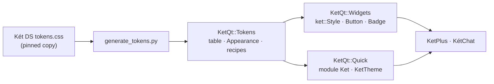

# KetQt architecture

## Targets

| Target | Contents | Qt modules |
|---|---|---|
| `KetQt::Tokens` | `ket::Tokens` (generated table), `ket::Appearance`, `ket::*Recipe` | Core, Gui |
| `KetQt::Widgets` | `ket::Style`, `ket::Button`, `ket::Badge` | Widgets |
| `KetQt::Quick` + `KetQt::QuickPlugin` | QML module `Ket`: `KetTheme`, `KetButton`, `KetBadge` | Qml, Quick, QuickControls2 |

## Tokens

- Names are the CSS custom property without `--kv-`: `ket::Tokens::color(u"page-bg", theme)`.
- Lengths are logical pixels at 100% zoom (`1rem` = 16 px). Durations are milliseconds.
  Colours are `#RRGGBB` or `#AARRGGBB`.
- Only the desktop values are generated: the base `:root` and `[data-kv-design-system]`
  blocks. Media queries, density variants and `prefers-reduced-motion` are ignored.
- QML reads the same table as `KetTheme.t` with camelCase keys (`KetTheme.t.pageBg`).

### Updating the design system

1. Copy `tokens.css` from the new `@ketvietlab/design-system` revision into
   `third_party/ket-design-system/`, and update `SOURCE.json` (version, revision, sha256).
2. Run `python3 tools/generate_tokens.py` and review the diff of `tokens/ket-tokens.json`.
3. Run the tests and compare the kitchensink pages in light and dark.

## Appearance and zoom

`ket::Appearance::instance()` is the only theme state. `Mode::System` follows
`QStyleHints::colorScheme()`; `setMode()` pins Light or Dark. `setZoom()` scales token
lengths to whole pixels (hairlines of 1 px or less stay as they are). Apps that already
have an appearance setting forward it here instead of keeping a second theme.

In QML, pass `KetTheme.dark` and `KetTheme.zoom` to recipe functions and `KetTheme.px()`
so bindings re-evaluate; recipes returned to QML are already scaled.

## Adding a component

1. Add a recipe (`KetRecipes.h`) built only from tokens, with a token test.
2. Draw it in `src/widgets/` and `src/quick/qml/`; neither layer chooses colours itself.
3. Add a Widgets test and a Quick test that compare against the same recipe.
4. Add it to a kitchensink page (`examples/kitchensink`) in every variant, size and pinned
   state, and check light, dark and 125% zoom
   (`--page=<id> --dark --zoom=1.25 --screenshot=<file>`).

Planned next, from the KetPlus and KétChat inventories: IconButton, TextField, Checkbox,
Switch, Menu, Tooltip, Tag (label-only chip), ListRow (two-line sidebar row), Dialog.

## Consuming KetQt

- Pin a release tag as a Git submodule and `add_subdirectory()` it with
  `KETQT_BUILD_TESTS=OFF` and `KETQT_BUILD_EXAMPLES=OFF`. Link the targets above.
- A Widgets app calls `ket::Style::install(app)` once after creating `QApplication`.
- A QML app links `KetQt::Quick` and `KetQt::QuickPlugin`, adds
  `Q_IMPORT_QML_PLUGIN(KetPlugin)` once and writes `import Ket`.
- `cmake --install` also installs `KetQt::Tokens` and `KetQt::Widgets` as a CMake package
  (`find_package(KetQt)`). The static QML module is not installed yet.

## Fonts

The kit does not bundle fonts. `font-sans` names KÉT Sans, then Inter. The first
installed family is used, and otherwise the platform font. An app that is licensed to
ship KÉT Sans or Inter registers it with `QFontDatabase` before creating windows.
