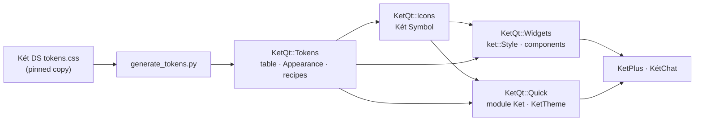

# KetQt architecture

## Targets

| Target | Contents | Qt modules |
|---|---|---|
| `KetQt::Tokens` | `ket::Tokens` (generated table), `ket::Appearance`, `ket::Profile`, `ket::*Recipe` | Core, Gui |
| `KetQt::Icons` | `ket::Icons`: Két Symbol resources, size and weight rules | Gui, Svg |
| `KetQt::Widgets` | `ket::Style`, `ket::Button`, `ket::IconButton`, `ket::Badge`, `ket::Tag`, `ket::Icon`, `ket::TextField`, `ket::Select`, `ket::Checkbox`, `ket::Radio`, `ket::Choice`, `ket::FieldRow` | Widgets |
| `KetQt::Quick` + `KetQt::QuickPlugin` | QML module `Ket`: `KetTheme`, `KetButton`, `KetIconButton`, `KetBadge`, `KetTag`, `KetIcon`, `KetTextField`, `KetSelect`, `KetCheckbox`, `KetRadio`, `KetChoice`, `KetFieldRow` | Qml, Quick, QuickControls2 |

## Tokens

- Names are the CSS custom property without `--kv-`: `ket::Tokens::color(u"page-bg", theme)`.
- Lengths are logical pixels at 100% zoom (`1rem` = 16 px). Durations are milliseconds.
  Colours are `#RRGGBB` or `#AARRGGBB`.
- Only the desktop values are generated: the base `:root` and `[data-kv-design-system]`
  blocks. Media queries, density variants and `prefers-reduced-motion` are ignored.
- QML reads the same table as `KetTheme.t` with camelCase keys (`KetTheme.t.pageBg`).

### Updating the design system

1. Copy `tokens.css` from the new `@ketvietlab/design-system` revision into
   `third_party/ket-design-system/`, and update `SOURCE.json` (version, revision, sha256).
2. Run `python3 tools/generate_tokens.py` and review the diff of `tokens/ket-tokens.json`.
3. Run the tests and compare the kitchensink pages in light and dark.

## Appearance and zoom

`ket::Appearance::instance()` is the only theme state. `Mode::System` follows
`QStyleHints::colorScheme()`; `setMode()` pins Light or Dark. `setZoom()` scales token
lengths to whole pixels (hairlines of 1 px or less stay as they are). Apps that already
have an appearance setting forward it here instead of keeping a second theme.

In QML, pass `KetTheme.dark` and `KetTheme.zoom` to recipe functions and `KetTheme.px()`
so bindings re-evaluate; recipes returned to QML are already scaled.

## Component scope and product profiles

Components are added in the order the KetPlus desktop mock uses them (`ketplus.ketatlas` in
`ketvietlab/ketplus`, built on the same Két DS release).

A recipe takes its colours from tokens, choosing which token fills, borders and colours
each state. It takes the metrics a product decides from the current `ket::Profile`
(decision 0002): sizes, spacing, weights and opacities.

- **`Profile::ketPlus()`** is the default. It holds the KetPlus mock's literals, each next to
  its source rule, for example the 7 px `.btn` gap, the 30 px `.icon-btn`, the 0.48
  disabled opacity and the 18 px tag. Its font sizes are the mock's at its default 15 px
  interface size.
- **`Profile::designSystem()`** uses tokens only.
- **Other products**, such as Lampion OS, install their own profile before creating
  windows.

Focus is drawn inside a control's bounds (a 2 px `focus-border` border on fields, a ring
around toggles), not as the mock's outside outline, which Qt Widgets cannot paint. The
composer text area stays in the app; the select popup uses the platform list until the
Menu component lands.

Icons are Két Symbol 0.11.0 (`third_party/ket-symbol`, CC BY 4.0, separate files with
their own notice), compiled into `KetQt::Icons` by `tools/generate_icons.py`:

- `ket::Icons` names icons by Két code; `codeForLucide()` maps KetPlus' Lucide names.
- A box draws the nearest master (14, 16, 20 or 24 px; the smaller on a tie): 14 px compact
  icons their own drawing, 17-18 px the 16 px master, 19-22 px the 20 px master and 23 px or
  more the 24 px master. The master is drawn at its own size and centred on whole device
  pixels (`offset()`); only a box smaller than its master scales it down.
- Light is the default weight; Regular is for emphasis. A filled variant never marks
  selection.
- `ket::Icons::icon()` is a `QIcon` with those rules; `ket::Icon` and `KetIcon` draw a
  standalone icon. Components draw icons in their text colour (the mock's `currentColor`):
  rendered at size × device pixel ratio and filled with `SourceIn`, which keeps the alpha.
  `KetButton` and `KetIconButton` take a Két code as `iconName`; `icon.source` still takes
  any other monochrome icon.

Colours that are user data, such as tag colours, are parameters.

| Done | Next, from the mock |
|---|---|
| Button (primary, secondary, ghost, danger, ghost danger), IconButton, Badge (neutral, brand, success, warning, …), Tag, Icon, TextField (with a leading icon for search), Select, Checkbox, Radio, Choice card, Field row, Banner, Toast, Dialog, Context menu (also the Select popup), Tooltip, Nav item, Kbd, Segmented control, Tab strip, Progress bar, Activity indicator, Empty state | Conversation rows (two-line sidebar rows with tags), composer, transcript blocks |

### Overlays

- **Dialogs and toasts draw inside their window**, as the mock's `.modal-backdrop` and
  `.toast` do, not as separate top-level windows. `ket::Dialog` covers its window, keeps
  Tab inside the card and rejects on Escape, the close button or a backdrop click.
  `KetDialog` is a modal `Dialog` in the window overlay.
- **Menus are drawn by `ket::Style`**, so every `QMenu` and the `QComboBox` popup
  (`SH_ComboBox_Popup`) look like `.desktop-context-menu`. `Style::setDanger()` and
  `Style::setDescription()` mark a destructive command and add its secondary line. macOS
  hides shortcuts in context menus (`Qt::AA_DontShowShortcutsInContextMenus`); `KetMenuItem`
  shows its `shortcut` everywhere.
- **Tooltips use the accent background**, like the native KetPlus `KetToolTip`.
- **Tab strips and progress bars are drawn by `ket::Style`** for every top `QTabBar`
  (`.file-tabs`) and horizontal `QProgressBar` (`progress`); other orientations stay Fusion.
  An indeterminate bar sweeps a segment, which the mock does not define.
- **The activity indicator** is the mock's `.working-bars`; `ket::activityBarFrame()` holds
  the keyframes, so both layers animate identically and screenshots can freeze a frame.
- **Shadows** are parsed from shadow tokens (`ket::shadowToken`) and drawn with concentric
  translucent layers (`KetShadow`), so neither layer needs a graphics effect or a shader.

## Adding a component

1. Add a recipe (`KetRecipes.h`) built from tokens, with a token test. A new product metric
   becomes a `ket::Profile` field, set in both `designSystem()` and `ketPlus()`.
2. Draw it in `src/widgets/` and `src/quick/qml/`; neither layer chooses colours itself.
3. Add a Widgets test and a Quick test that compare against the same recipe.
4. Add it to a kitchensink page (`examples/kitchensink`) in every variant, size and pinned
   state, and check light, dark and 125% zoom
   (`--page=<id> --dark --zoom=1.25 --screenshot=<file>`, `--full` for the whole page).
   Run `--smoke` on a real display as well as offscreen: it also checks that every Qt Quick
   view matches its root size.

## Consuming KetQt

- Pin a release tag as a Git submodule and `add_subdirectory()` it with
  `KETQT_BUILD_TESTS=OFF` and `KETQT_BUILD_EXAMPLES=OFF`. Link the targets above.
- A Widgets app calls `ket::Style::install(app)` once after creating `QApplication`.
- A QML app links `KetQt::Quick` and `KetQt::QuickPlugin`, adds
  `Q_IMPORT_QML_PLUGIN(KetPlugin)` once and writes `import Ket`.
- `cmake --install` also installs `KetQt::Tokens`, `KetQt::Icons` and `KetQt::Widgets`, with the
  Két Symbol notice and licence, as a CMake package
  (`find_package(KetQt)`). The static QML module is not installed yet.

## Fonts

The kit does not bundle fonts. `font-sans` names KÉT Sans, then Inter. The first
installed family is used, and otherwise the platform font. An app that is licensed to
ship KÉT Sans or Inter registers it with `QFontDatabase` before creating windows.
